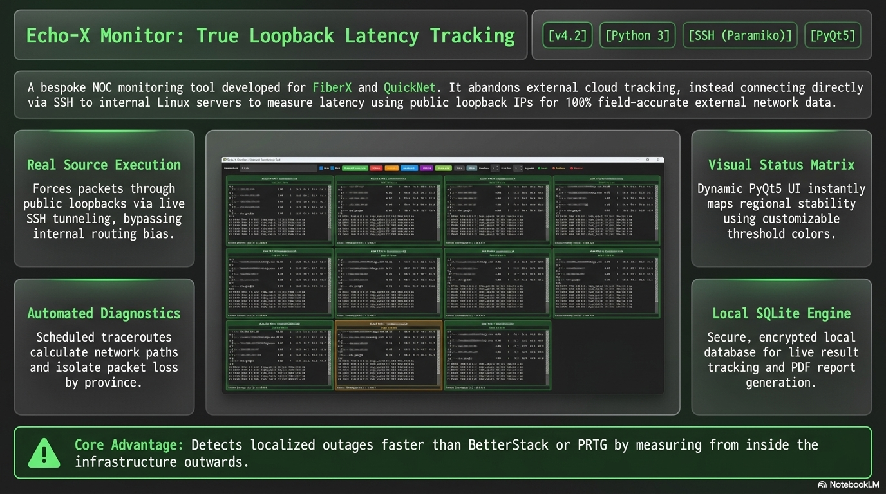
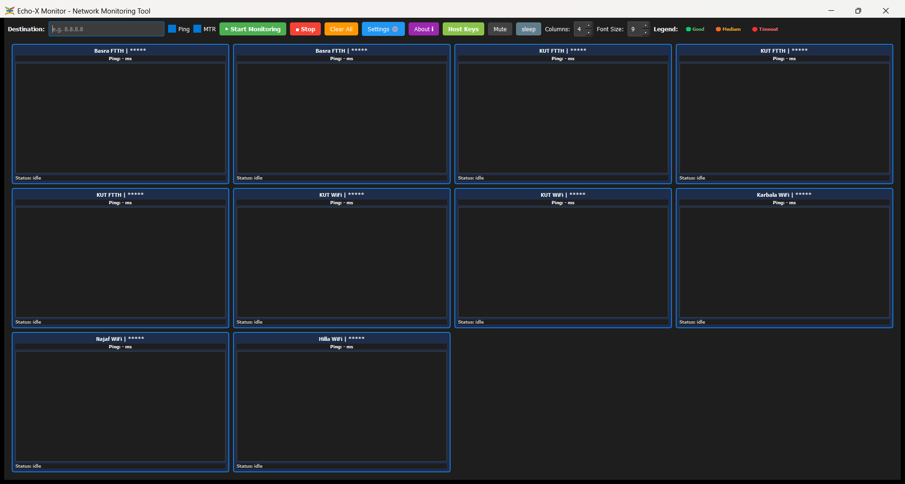

<h1 align="center">Echo-X Monitor</h1>

<p align="center"><b>Network latency monitor with ping/MTR, alarms and drag-and-drop hosts</b></p>

<p align="center">
  
  
  
  <a href="https://github.com/alisadhk/echo-x-monitor/releases/latest"></a>
</p>

---

## Overview
Echo-X Monitor is a PyQt5 network monitoring tool. It pings and traces (MTR) many destinations, colors each host by latency and raises sound alarms when a host becomes slow or unreachable. Predefined locations can use SSH sources to measure latency from remote probes.

## Features
- Ping and MTR to any destination
- Latency thresholds with four colors (good, medium, warning, error)
- Sound alarms (Windows beep or your own WAV) and softer warnings
- Drag and drop host ordering, column count and font-size controls
- Snooze and host keys shortcuts
- License activation dialog
- True loopback latency: measures through live SSH tunnels to internal Linux servers using public loopback IPs
- Scheduled traceroutes to isolate packet loss by region
- Local SQLite storage and PDF report generation (as described in the project notes)
- Visual status matrix with customizable threshold colors

## How it works
- Each tile in the grid is a monitored location with its own SSH probe.
- Echo-X connects to the probe over SSH (paramiko) and runs ping/MTR from there, so you measure from inside the network outwards.
- Every reply is compared with your thresholds and the tile changes color (good / medium / warning / error).
- Alarm sounds play when a tile enters red; **Snooze** and **Mute** silence them temporarily.

## Requirements
- Windows 10/11.
- SSH access to your probe servers (fill the LOCATIONS table in the source).
- Python 3.10+, PyQt5 and paramiko when running from source.

## Screenshots
<p align="center"></p>
<p align="center"></p>

## Download and install
### Option A - Ready-to-run download (recommended)
1. Open the **[Releases page](https://github.com/alisadhk/echo-x-monitor/releases/latest)**.
2. Download the file(s) listed under **Assets**:

| File | Size |
|---|---|
| `Echo-X-Monitor.exe` | 38.1 MB |
| `Echo-X-Monitor-archive.rar` | 37.7 MB |

3. Run it. 

### Option B - Run from source
Requirements: Windows 10/11 and Python 3.10+.

```bash
git clone https://github.com/alisadhk/echo-x-monitor.git
cd echo-x-monitor
python -m pip install -r requirements.txt
python 666.py
```

## How to use
1. Enter a destination (for example 8.8.8.8) and press **Ping** or **MTR**.
2. Open **Settings** to set the ping thresholds, colors and alarm sounds.
3. Use **Host Keys** to bind shortcuts and **Snooze** to mute alarms temporarily.
4. Use **Clear All** to reset the dashboard.

## Configuration and privacy
- All sensitive values from the original private version (passwords, tokens, license codes, user names, internal IP addresses, personal names and links) were replaced with `*****`.
- The LOCATIONS table (SSH hosts, users, passwords and source IPs) is fully masked. Fill in your own probes to use the remote-source feature.
- The license key is masked; set your own in 666.py.

## Troubleshooting
- Tiles stay idle: the masked ***** values must be replaced with your own hosts, users and sources.
- No sound: check **Settings > Sound Alerts** and Windows volume.
- Window too crowded: change **Columns** and **Font Size**.

## Build the executable yourself
```bash
python -m pip install pyinstaller
python -m PyInstaller --noconfirm 666.spec
```
The executable is created in the `dist/` folder.

## Notes
- Windows only (uses Windows sound and ping behavior).

---

<p align="center">Maintained by <a href="https://github.com/alisadhk">@alisadhk</a> - last update 2026-04-15</p>